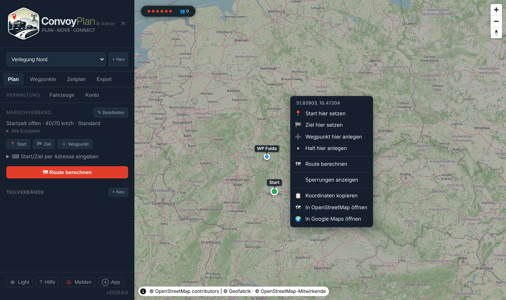
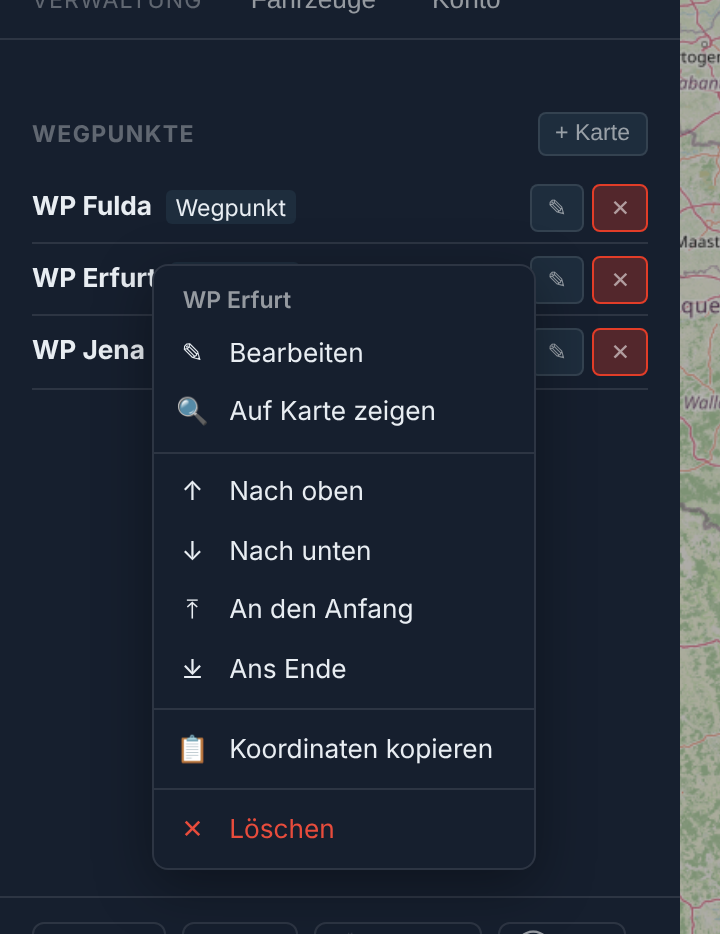
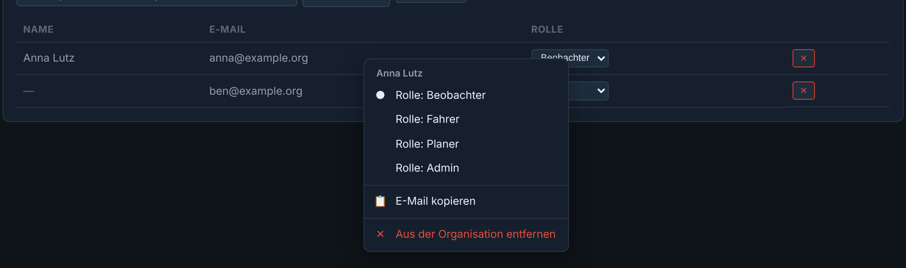
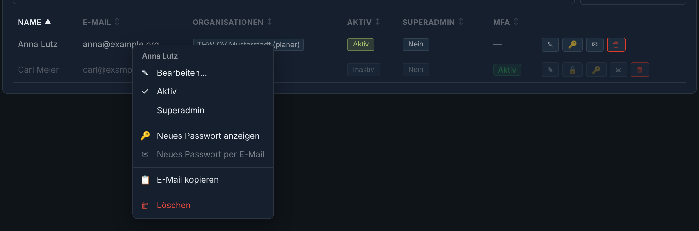

# Benutzerhandbuch

Dieses Handbuch richtet sich an Planer, Fahrer und Administratoren, die ConvoyPlan im Alltag verwenden.

---

## Rollen

| Rolle | Berechtigungen |
|---|---|
| **Beobachter** | Routen und Live-Tracking lesen |
| **Fahrer** | Eigene Position aktualisieren, Fahrzeugstatus setzen |
| **Planer** | Konvois erstellen und bearbeiten, Fahrzeuge zuordnen, Routen berechnen |
| **Admin (Org)** | Alle Planer-Rechte + Organisationsverwaltung |
| **Superadmin** | Vollzugriff auf alle Bereiche und Benutzer |

---

## Anmeldung

1. Die Anwendung im Browser öffnen (z. B. `https://convoy.example.com`).
2. E-Mail-Adresse und Passwort eingeben.
3. Auf **Anmelden** klicken.

> Beim ersten Start der Instanz wird automatisch auf den **Setup-Wizard** weitergeleitet. Dieser muss zuerst abgeschlossen werden, bevor eine Anmeldung möglich ist.

---

## Ersteinrichtung (Setup-Wizard)

Der Setup-Wizard erscheint automatisch beim ersten Start.

### Schritt 1 – Superadmin-Account

E-Mail-Adresse und Passwort für den Superadmin-Account eingeben. Dieser Account hat vollen Zugriff auf alle Einstellungen.

### Schritt 2 – Domain und SSL

- **Domain:** Den vollständigen Domainnamen eingeben (z. B. `convoy.example.com`). Für lokale Tests `localhost` verwenden.
- **TLS-Modus wählen:**
  - *Let's Encrypt* – automatisches öffentliches Zertifikat (erfordert öffentlich erreichbare Domain)
  - *Eigenes Zertifikat* – PEM-Zertifikat und Schlüssel hochladen
  - *Intern* – selbstsigniertes Zertifikat für lokale Nutzung

### Schritt 3 – Abschluss

Caddy wird automatisch neu geladen. Danach ist die Anmeldung direkt möglich.

---

## Kontextmenü (rechte Maustaste)

Fast überall, wo eine Zeile oder ein Punkt Knöpfe trägt, öffnet die **rechte Maustaste**
ein Menü mit denselben Aktionen — am Telefon **lange drücken**, per Tastatur die Taste
*Kontextmenü* oder **Umschalt+F10**. Das Menü ist eine Abkürzung: alles darin gibt es
auch als Knopf.

*Rechtsklick auf die Karte: oben die Koordinaten der Stelle, darunter, was sich dort setzen lässt.*

| Wo | Was im Menü steht |
|---|---|
| **Karte der Planung** | Start/Ziel hier setzen, Wegpunkt oder Halt hier anlegen, Route berechnen, ganze Route zeigen, Karte einnorden, Sperrungen/Verkehrslage ein- und ausblenden, Koordinaten kopieren, in OpenStreetMap oder Google Maps öffnen |
| **Marker auf der Karte** | Wegpunkt: bearbeiten, umsortieren, löschen · Start/Ziel: neu setzen |
| **Wegpunktliste** | Bearbeiten, auf Karte zeigen, nach oben/unten, an den Anfang/ans Ende, Koordinaten kopieren, löschen |
| **Fahrzeuge** | Bearbeiten, zum Verband hinzufügen bzw. herausnehmen, Funkrufname/Kennzeichen kopieren, löschen |
| **Marschfolge** | Eine Position vor/zurück, an die Spitze, ans Ende, aus dem Verband nehmen |
| **Marschverband** (Kopf der Seitenleiste) | Bearbeiten, Route berechnen, Marschbefehl, Roadbook, GPX, Tracking-Ansicht, Link kopieren, öffentlich teilen |
| **Konvoi-Ansicht (Tracking)** | Fahrzeug auf Karte zeigen, Karte folgen lassen, Funkrufname und Position kopieren; auf der Karte im manuellen Modus „Meine Position hierher" |
| **Org-Admin** | Mitglieder: Rolle wechseln, E-Mail kopieren, entfernen · Leitstellen · GPS-Freigaben · KI-Verbindungen |
| **Admin-Bereich** | Benutzer: bearbeiten, aktiv/Superadmin schalten, Passwort, MFA, löschen · Organisationen · Leitstellen · API-Keys |

<table>
<tr>
<td width="50%"></td>
<td width="50%">  </td>
</tr>
<tr>
<td><em>Wegpunktliste: umsortieren ohne Ziehen.</em></td>
<td><em>Org-Admin und Admin-Bereich: Punkt bzw. Haken zeigen den aktuellen Stand. Was gerade nicht geht, ist ausgegraut — z. B. Passwort per E-Mail ohne eingerichteten Mailversand.</em></td>
</tr>
</table>

In **Eingabefeldern**, auf **Links** und auf **markiertem Text** bleibt das gewohnte Menü des
Browsers (Einfügen, Kopieren, in neuem Tab öffnen). Wer es auch anderswo braucht, hält beim
Rechtsklick **Umschalt** gedrückt.

Mit der Tastatur: **Pfeiltasten** wählen, **Enter** führt aus, **Esc** schließt; ein
Anfangsbuchstabe springt zum passenden Eintrag.

---

## Fahrzeuge verwalten

Fahrzeuge werden einmalig angelegt und können dann beliebigen Konvois zugeordnet werden.

### Fahrzeug anlegen

1. Im Menü **Fahrzeuge** öffnen.
2. **Neues Fahrzeug** klicken.
3. Felder ausfüllen:
   - **Funkrufname** (z. B. `RTW 1-1`)
   - **Kennzeichen**
   - **Abmessungen** (Länge, Breite in Metern)
   - **Gewicht** (kg)
   - **Kraftstoffart und Tankdaten** (für Kraftstoffplanung)
4. Speichern.

---

## Marschverband planen

### Neuen Konvoi erstellen

1. **Planung** im Menü öffnen.
2. **Neuer Konvoi** klicken und den Wizard starten:
   - Name und Beschreibung eingeben
   - Startzeit festlegen
   - Marschgeschwindigkeiten (innerorts / außerorts) eintragen
   - Fahrzeuge aus der Liste auswählen und zuordnen

### Wegpunkte setzen

1. Den Konvoi öffnen und zur **Kartenansicht** wechseln.
2. Auf der Karte Klicken um Wegpunkte zu setzen, oder über die Seitenleiste manuell hinzufügen.
   - Alternativ zum Kartenklick lässt sich jeder Punkt über die **Adresssuche** setzen: Start, Ziel und jeder Wegpunkt haben ein eigenes Suchfeld, das schon während des Tippens Vorschläge liefert.
3. Für jeden Wegpunkt kann festgelegt werden:
   - **Typ:** Start, Stopp, Kontrollpunkt, Tankhalt, Technischer Halt
   - **Haltezeit** in Minuten
   - **Zweck / Notiz**

### Route berechnen

1. Mindestens Start- und Zielpunkt setzen.
2. **Route berechnen** klicken.
3. GraphHopper berechnet die Route; ConvoyPlan erstellt automatisch den Zeitplan mit streckenproportionalen Ankunfts- und Abfahrtszeiten je Wegpunkt (ein Wegpunkt bei 40 % der Strecke bekommt auch 40 % der Fahrzeit als ETA). Der **Zeitplan**-Tab zeigt zusätzlich eine **Abmarsch**-Zeile (Startzeit) und eine **Ziel**-Zeile mit der Gesamt-Ankunftszeit.
4. Was die Berechnung über die Strecke sagt, steht im Tab **Route**: Tank- bzw. Ladestopp, empfohlene Halte, **Durchfahrtshöhen** und **Gewichtsgrenzen**. Die Zahl am Tab nennt die offenen Hinweise – rot bei fehlendem Tankstopp, enger Durchfahrt oder überschrittener Grenze. Gibt es Hinweise, öffnet ConvoyPlan nach der Berechnung den Tab **Route**, sonst den **Zeitplan**. Höhen und Gewichte stehen eingeklappt mit ihrem Befund in einer Zeile und klappen von selbst auf, sobald eine Stelle zu prüfen ist.

### Konvoi bearbeiten

Bestehende Konvois können jederzeit vollständig bearbeitet werden: Name, Beschreibung, Start-/Endzeit, Geschwindigkeitsprofile und Wegpunkte.

---

## Teilverbände (Sub-Convoys)

Für mehrstufige Marschverbände können Teilverbände angelegt werden.

1. Einen Konvoi öffnen.
2. **Neuer Teilverband** klicken.
3. Name und Fahrzeuge des Teilverbandes eingeben.
4. Der Teilverband ist dem übergeordneten Konvoi zugeordnet.

---

## Export und Freigabe

### Marschbefehl als PDF

1. Konvoi öffnen → Reiter **Export**.
2. **PDF herunterladen** klicken.
3. Der Marschbefehl enthält Zeitplan, Wegpunkte, Fahrzeugliste und Kanalwechsel.

### GPX / JSON exportieren

1. Konvoi öffnen → Reiter **Export**.
2. **GPX exportieren** oder **JSON exportieren** wählen.
3. Die Datei kann in Navigationsgeräten oder zur Dokumentation verwendet werden.

### Route importieren

1. Konvoi öffnen → Reiter **Export** → Abschnitt **Import**.
2. GPX-Track oder GeoJSON-Datei hochladen.
3. Die Route wird in den Konvoi übernommen.

### Tracking-Link (Freigabe ohne Login)

1. Konvoi öffnen → **Teilen** (Dialog **Live-Tracking teilen**).
2. Rolle des Links wählen:
   - **Nur ansehen** – Empfänger verfolgen den Verband live (Viewer).
   - **Fahrer** – Empfänger können zusätzlich ohne Konto ein Fahrzeug wählen und Position/Status senden.
3. Passwortschutz wählen: *ohne Passwort*, *Passwort generieren* (10 Zeichen, wird **nur einmal** angezeigt) oder *Passwort selbst setzen* (min. 4 Zeichen).
4. **Link erstellen** und den Link – bei Passwortschutz getrennt davon das Passwort – weitergeben.

Die Liste **Vorhandene Links** zeigt Rolle, Passwortschutz, letzten Zugriff und Aufrufzähler; **Widerrufen** macht einen Link sofort ungültig.

> Ein **Fahrer-Link ist ein Schreibzugriff**: Wer ihn hat, kann für ein beliebiges Fahrzeug des Konvois Position und Status senden – ein versehentlich gesetzter Ausfall alarmiert alle Beteiligten. Für Fahrer-Links deshalb immer ein Passwort setzen. Details: [Teilen & Öffentliche Ansicht](Teilen).

---

## Live-Tracking

### Als Fahrer

1. Den Konvoi öffnen → Reiter **Tracking** (oder einen **Fahrer-Tracking-Link** öffnen).
2. Das eigene Fahrzeug auswählen und die Browser-Standortfreigabe erlauben.
3. **Tracking starten** – die Position wird laufend übermittelt. Ohne HTTPS oder ohne Freigabe lässt sie sich per Tippen auf die Karte setzen.
4. Status im Reiter **Status** unter **Mein Status** melden:
   - *Geplant* → *Unterwegs* → *Angekommen*
   - **Techn. Halt** mit Dringlichkeit *Standard*, *Dringend* oder *Sehr dringend*
   - **Ausfall/Störung** als *Totalausfall – sofort halten* oder *Eingeschränkt – in Sicherheit fahren*
   - Zu Halt und Ausfall lässt sich eine kurze Bemerkung mitgeben.

### Als Beobachter / Planer

1. Den Konvoi öffnen → Reiter **Tracking**.
2. Alle Fahrzeugpositionen werden in Echtzeit auf der Karte angezeigt, eingefärbt nach Status.
3. **Techn. Halt** und **Ausfall** lösen bei allen Verbundenen einen Alarm mit Banner, Ton und Vibration aus; über **Anzeigen** geht es in den Reiter **Status**, **Quittieren** blendet ihn aus.
4. Erreichte **Wegpunkte** und **Leitstellenwechsel** werden automatisch angekündigt, sobald die Spitze des Verbands den Punkt passiert.
5. Der Reiter **Zeitplan** zeigt die aus der Position berechnete **Verspätung** und verschiebt die Ankunftszeiten aller Wegpunkte entsprechend.
6. Über **Norden** und **Fahrtrichtung** lässt sich die Karte ausrichten; reißt die Verbindung ab, meldet ein Banner den Ausfall der Übertragung.

Ausführlich: [Live-Tracking](Live-Tracking).

---

## Lagedaten

GeoJSON-Lagedaten können als zusätzliche Kartenebenen hochgeladen werden (z. B. Sperrzonen, Sammelplätze, Einsatzräume).

1. Konvoi öffnen → Reiter **Lage**.
2. **Layer hochladen** klicken und eine GeoJSON-Datei auswählen.
3. Der Layer wird sofort auf der Karte angezeigt.
4. Layer können ein- und ausgeblendet oder gelöscht werden.

---

## Wetter und Sperrungen

### Wetter

- Das Wetter-Widget wird direkt auf der Planungskarte angezeigt.
- Daten kommen von Open-Meteo – kein API-Key erforderlich.

### Sperrungen und Baustellen

1. In der Kartenansicht das **Sperrungen-Layer** aktivieren.
2. Aktuelle Sperrungen und Baustellen entlang der gesamten Route werden angezeigt – zusammengeführt aus OpenStreetMap/Overpass, der offiziellen Autobahn-API (bund.dev), lizenzfreien offenen Baustellenfeeds (MobiData BW, Berlin VIZ) und optional DATEX-II-Feeds der mobilithek (weitere Bundesländer, auch mTLS-geschützt). Fällt eine Quelle aus, liefern die anderen weiterhin Ergebnisse. **Hinweis:** Die amtlichen Feeds sind je Land einzeln einzurichten (siehe [Verkehrsdaten](Verkehrsdaten)). Ohne dieses Setup kommen Sperrungen auf österreichischen und Schweizer Streckenteilen aus OpenStreetMap/Overpass und der Live-Verkehrslage. Auf der Karte sind die Meldungen nach Schweregrad eingefärbt (rot = Voll-/Sperrung, gelb = Warnung/Hindernis, orange = Baustelle).

### Live-Verkehrslage (Stau)

Zeigt die Fließgeschwindigkeit entlang der Route als Ampel-Ebene (grün → gelb → rot) – wie bei Google Maps.

1. Die Funktion ist nur aktiv, wenn ein Superadmin einen HERE- oder TomTom-API-Key hinterlegt hat (Admin-Bereich oder Umgebungsvariable). Ohne Key erscheint kein Schalter.
2. Im Export-Tab bzw. auf der Planungskarte den Schalter **Verkehrslage laden** aktivieren.
3. Die Verkehrsdaten werden als farbige Linien direkt über die Karte gelegt.

> HERE/TomTom decken den gesamten DACH-Raum ab – anders als die regionalen offenen Baustellenfeeds. Die Nutzungsbedingungen des jeweiligen Anbieters sind vor Produktivbetrieb zu prüfen.

---

## Leitstellen und Kanalwechsel

Leitstellen definieren Zuständigkeitsbereiche. Bei der Routenberechnung werden automatisch Kanalwechselpunkte ermittelt und im Zeitplan sowie im PDF ausgewiesen.

### Leitstelle anlegen (Admin)

1. **Admin-Bereich** öffnen → Reiter **Leitstellen**.
2. **Neue Leitstelle** klicken.
3. Name und Zuständigkeitsgebiet eintragen. Für das Gebiet gibt es zwei Wege:
   - **Gebiet wählen** – fertige Verwaltungsgrenzen anklicken: Landkreise und kreisfreie Städte (Deutschland), politische Bezirke (Österreich), Kantone (Schweiz) sowie Liechtenstein. Bereits vergebene Gebiete sind grau; der Tooltip nennt Name, Bundesland bzw. Land und ggf. die Leitstelle, die es schon belegt.
   - **Polygon zeichnen** – freie Grenze direkt auf der Karte, für Zuständigkeiten, die keiner Verwaltungsgrenze folgen.

   Die Übersichtstabelle gruppiert Leitstellen nach Bundesland; Schweizer und Liechtensteiner Leitstellen stehen unter dem Landesnamen, weil es dort unterhalb des Bundes keine weitere Ebene gibt.

---

## Organisationen

Organisationen ermöglichen die mandantenfähige Nutzung: jede Organisation hat eigene Mitglieder und Rollen.

### Organisation anlegen

1. Im Menü **Organisationen** öffnen.
2. **Neue Organisation** anlegen.

### Mitglieder einladen

1. Organisation öffnen → **Mitglied einladen**.
2. E-Mail-Adresse eingeben und Rolle wählen.

### Rollen

| Rolle | Vergabe durch |
|---|---|
| Beobachter | Org-Admin |
| Fahrer | Org-Admin |
| Planer | Org-Admin |
| Org-Admin | Org-Admin oder Superadmin |

---

## Admin-Bereich

Superadmins haben Zugriff auf alle Verwaltungsfunktionen.

### Benutzer verwalten

1. **Admin** → **Benutzer**.
2. Benutzer aktivieren, deaktivieren oder Rolle ändern.

### Branding anpassen

1. **Admin** → **Branding**.
2. Logo hochladen, Primär- und Akzentfarbe sowie App-Name anpassen.
3. Eine Live-Vorschau zeigt die Änderungen sofort.

> Dies ist das **globale Plattform-Branding**. Jede Organisation kann zusätzlich ein eigenes Branding im Org-Admin-Bereich hinterlegen, das nur innerhalb ihres `/o/[slug]`-Bereichs gilt – siehe [Multi-Tenancy](Multi-Tenancy#org-spezifische-login-seite-und-branding).

### System und Updates

1. **Admin** → **Software-Update**.
2. Aktuelle und verfügbare Version werden angezeigt.
3. **Update-Kanal** wählen: **Stable** (Standard – nur veröffentlichte Releases), **Beta** (nummerierte Vorabversionen/Release-Kandidaten) oder **Nightly** (jeder Commit auf `main`, für Tests).
4. **Update-Modus** wählen: **Automatisch** (Standard – installiert verfügbare Updates im gewählten Kanal ohne weiteres Zutun) oder **Benachrichtigen** (informiert Superadmins per E-Mail, Installation erfolgt bewusst über **Jetzt updaten**).
5. Der Updater prüft standardmäßig alle 5 Minuten (`UPDATE_INTERVAL`) auf neue Stände im gewählten Kanal.
6. Optional: E-Mail-Benachrichtigung an alle aktiven Superadmins **nach** einem automatischen Update aktivieren.

### Live-Verkehrslage-Keys (Admin)

1. **Admin** → **Live-Verkehrslage (Stau)**.
2. HERE- und/oder TomTom-API-Key hinterlegen und bevorzugten Anbieter wählen.
3. Der Status zeigt, ob ein Key gesetzt ist (Datenbank oder Umgebungsvariable) und welcher Anbieter aktiv ist. Der gespeicherte Key wird nie im Klartext angezeigt.

### Demo-Sitzungen (Admin)

Jede Demo-Nutzung läuft als eigene, befristete Organisation.

1. **Admin** → **Demo-Sitzungen** zeigt alle offen laufenden Demo-Sitzungen mit Name, Ablaufzeit und Anzahl angelegter Konvois.
2. Die Spalte **Herkunft** zeigt Stadt/Region/Land der Sitzung, ermittelt aus der Client-IP beim Start der Sitzung (Geolokation läuft im Hintergrund und verzögert den Demo-Start nie). Bei privaten oder nicht auflösbaren IPs (z. B. lokale Entwicklung) bleibt das Feld leer.
3. Sitzungen können hier verlängert oder sofort beendet werden. Herkunftsdaten werden zusammen mit der Demo-Organisation vom Retention-Job gelöscht — siehe [Lizenz und Demo-Modus](Lizenz-und-Demo-Modus#offene-demo-sitzungen-verwalten-admin).

---

## Häufige Probleme

| Problem | Lösung |
|---|---|
| Route wird nicht berechnet | GraphHopper-Logs prüfen: `docker compose logs -f graphhopper`. Erster Start dauert mehrere Minuten. |
| Login schlägt fehl | JWT_SECRET in `.env` prüfen. Nach Änderung alle Container neu starten. |
| Karte lädt nicht | Internetverbindung der Instanz prüfen — die Kacheln kommen über deren Kachel-Proxy (`/api/tiles/…`) von OpenStreetMap. |
| PDF ist leer | Route muss vor dem PDF-Export berechnet worden sein. |
| Tracking-Position wird nicht übertragen | Standortfreigabe im Browser erlauben. Verbindung zum WebSocket prüfen. |
